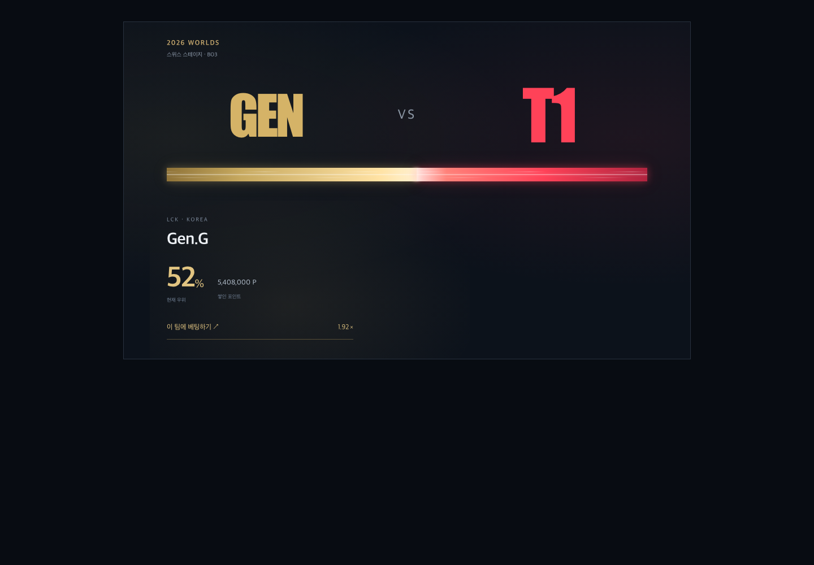

# 경기 단독 시안 09 · 베팅 지분 랭킹

[HTML 시안](3.match.html)은 외부 라이브러리 없이 열리는 디자인 문서다. 팀 마크는 임시 타이포그래피이며 경기와 수치는 샘플이다.

## 레이아웃과 동작

- 최상단 중앙에는 이벤트명과 대회 단계·경기 형식, 경기 날짜·시작 시각을 표시한다. 시간대는 한국 시간으로 명시한다. 현재는 `2026 WORLDS / 스위스 스테이지 · BO3`이며, 8강·준결승·결승 등의 단계도 같은 자리에서 표시한다. 그 아래에 팀 마크–VS–팀 마크를 크게 배치하고 바로 아래에 막대를 둔다. 전체 풀·보유 포인트와 전체 지분 랭킹 버튼은 경기 화면에 표시하지 않는다. 베팅 모달에서는 입력에 필요한 보유 포인트를 표시한다.
- 막대 아래에는 높이가 고정된 좌우 팀 영역을 둔다. 정보가 보이지 않을 때도 같은 공간을 확보한다. 상단과의 구분선이나 팀 영역의 테두리 없이 배경이 자연스럽게 이어진다.
- 평소에는 팀 로고와 VS, 움직이는 네온 막대와 양쪽 팀의 베팅 지분 TOP 5를 표시한다. 살펴보기 문구는 표시하지 않는다.
- 로고부터 막대·랭킹까지 포함한 경기 영역의 해당 팀 쪽을 호버하면 확보된 공간 안에서 양 팀 랭킹이 모두 사라지고 선택 팀 정보만 나타나며 해당 영역의 폭이 약 62%로 넓어진다. 영역의 높이는 바뀌지 않는다. 호버 진입·이동·이탈은 모두 같은 경기 영역의 고정 사각형을 기준으로 판정한다. 좌우 판정은 시각적 확대와 관계없이 중앙 50%를 기준으로 유지한다. 마우스가 경기 영역을 벗어나면 클릭으로 남은 포커스도 해제하고 즉시 중립 상태로 돌아가 양 팀 랭킹을 다시 표시한다. 소속 리그, 팀 명칭, 현재 우위 퍼센트, 쌓인 포인트와 베팅 버튼이 나타난다.
- 막대도 17px에서 24px 높이로 함께 확대된다. 최대 높이 24px를 레이아웃에 미리 확보하고 그 안에서 세로 중앙을 기준으로 확대하므로 바의 위치는 움직이지 않는다. 팀 세부 정보와 버튼은 바 아래의 고정 공간에서 나타난다. 경기 카드와 페이지 전체 높이도 호버 전후 동일하다. 막대의 색 비율은 실제 샘플 풀 비중을 유지하며 호버로 바뀌지 않는다.
- 바는 번개 시안의 가로 색 그라데이션과 중앙의 얇은 발광선을 복원한다. 둥근 모서리·입체 음영·사선 띠를 제거하고, 가느다란 빛이 수평으로 흐른다. 번개 이펙트는 사용하지 않는다. 접점은 두 팀 색이 부드럽게 섞인다. 기준선, 정배·역배와 부가 설명 문구는 표시하지 않는다.
- 베팅 버튼은 팀 색의 텍스트와 얇은 밑줄로 표현한다. 예상 배당도 함께 표시한다.

## 베팅 지분 랭킹

각 팀에 가장 많은 포인트를 건 사용자 5명을 내림차순으로 표시한다. 왼쪽은 왼쪽에서, 오른쪽은 오른쪽에서 시작하는 얇고 선명한 팀 색 막대다. GEN은 `#D5B367`, T1은 `#EF526C`를 사용한다. 막대 길이와 지분 %는 사용자 베팅액을 해당 팀 전체 풀로 나눈 값이다. 상위 1등을 100%로 늘리지 않는다.

닉네임은 기존 프론트엔드 랭킹의 이름과 굵기 표현을 가져온다. 응원 인장은 `TeamMark.vue`와 `style.css`의 작은 이니셜 방패를 어두운 화면에 맞게 조정한 임시 디자인이다. 이벤트 인장을 가진 사용자에만 닉네임 옆에 표시하며, 없는 사용자에게 박탈 표시를 붙이지 않는다.

지분 랭킹은 경기 화면의 TOP 5만 제공한다. 베팅 확정 시 내 베팅을 추가하고 순위·지분·풀을 함께 갱신한다.

## 터치와 키보드

터치 화면에서는 팀 로고를 눌러 펼친 뒤 베팅 버튼을 누른다. 키보드로 팀 로고에 포커스를 옮겨도 같은 정보가 펼쳐진다. 접힌 영역의 세부 정보는 `inert`로 포커스와 접근성 트리에서 제외한다. 영역 안에서 Escape를 누르면 접힌다. 움직임 줄이기 설정에서는 흐름과 확대 애니메이션을 끈다.

## 구현 범위와 데이터

HTML 화면에는 시안 번호·설명 링크·샘플 안내·검토용 버튼을 표시하지 않는다. 검토자에게 필요한 구현 범위는 이 문서에서 전달한다.

경기와 사용자·포인트는 고정된 가상 데이터이고 팀 마크와 인장은 이니셜 기반의 임시 표현이다. 실제 로고 에셋과 서버 데이터는 연결되어 있지 않다. 초기 GEN 5,408,000 P, T1 4,992,000 P의 52:48에서 시작한다.

베팅 모달의 확정은 페이지 메모리 안에서만 실행한다. 보유 포인트, 팀 풀, 지분 랭킹과 내 베팅 상태를 갱신하고 중복 베팅을 막는다. 입력 단계의 예상 수령액은 입력 금액을 풀에 더해 계산하고, 확정 후에는 이미 반영된 풀을 사용한다. 새로고침하면 초기 상태로 돌아간다. 회원 계정·서버 저장·실제 정산은 구현하지 않았다.

T1 응원 상태에서 GEN을 선택하면 확정 전 인장 박탈 안내를 모달 본체 아래의 상시 안내 박스로 표시한다. 상단 팀 선택만 좌우로 나누고 금액 입력·빠른 금액 선택·예상 수령액·확정 버튼은 전체 폭의 단일 흐름으로 배치한다. 보유 포인트는 금액 입력칸 위에 표시하고, 금액은 입력 중에도 세 자리마다 콤마로 구분한다. 커서 위치를 유지하며 숫자와 콤마 외 입력은 반영하지 않는다. 안내 박스는 기본 안내, 금액 오류, 인장 박탈 경고, 베팅 완료 메시지를 동적으로 표시하며 베팅한 팀과 금액도 여기서 확인한다. 본체의 별도 설명·성공 메시지 영역은 제거한다. 투명한 안내 슬롯 높이 108px를 항상 확보하여 팀 선택에 따른 모달 본체 위치·크기와 확정 버튼 위치를 유지한다. 작은 화면에서는 본체와 안내 박스가 각각 스크롤 가능하다. 확정 후에는 이 경기의 내 베팅을 확인하는 상태로 전환한다.

## 베팅 후 경기 화면

별도 내 베팅 요약이나 추가 슬롯을 만들지 않는다. 선택한 팀의 기존 5줄 랭킹 안에 본인이 항상 포함된다. 상위 5위 안에 있으면 원래 순위에 표시하고, 밖이면 상위 4명과 본인 행을 표시한다. 본인 행에는 실제 순위를 유지하고 `나` 표시와 은은한 팀 색 배경을 붙인다. 금액과 팀 내 지분은 같은 행에서 읽을 수 있다.

본인 행은 베팅 후에도 랭킹을 5줄로 유지하므로 카드 높이는 바뀌지 않는다. 호버 상태에서는 기존대로 양쪽 랭킹이 숨겨지고 팀 정보와 내 베팅 보기 버튼이 표시된다. 예상 수령액과 확정 상태는 내 베팅 모달에서 확인한다. 새로고침하면 초기화된다.

## 검토할 부분

- 마크에서 팀 영역으로 이동하는 흐름이 자연스러운가?
- 영역 확대와 정보 등장 속도가 적절한가?
- 로고 또는 바에 마우스를 올리면 베팅할 수 있다는 동작이 자연스러운가?
- 팀 정보와 베팅 버튼을 읽는 동안 레이아웃이 안정적인가?
- 터치 화면에서도 팀 탐색과 베팅이 편한가?

브라우저에서 호버·포커스 확대, 막대 상시 표시와 동시 확대, 풀·배당 계산과 메모리 내 베팅 확정, 모달과 금액 검증, 320–1440px 배치, Escape와 움직임 줄이기를 확인했다.

## 화면 캡처



- [기본 화면](previews/match-default.png)
- [모바일 팀 영역](previews/match-mobile.png)
- [베팅 모달](previews/match-bet.png)

## 같은 네트워크에서 열기

```sh
cd /Users/castell/Develops/lolpick
python3 -m http.server 5174 --bind 0.0.0.0 --directory docs/2.design
```

윈도우에서 `http://192.168.0.3:5174/3.match.html`을 연다. 프론트엔드의 5173 포트와 별도로 동작한다.
